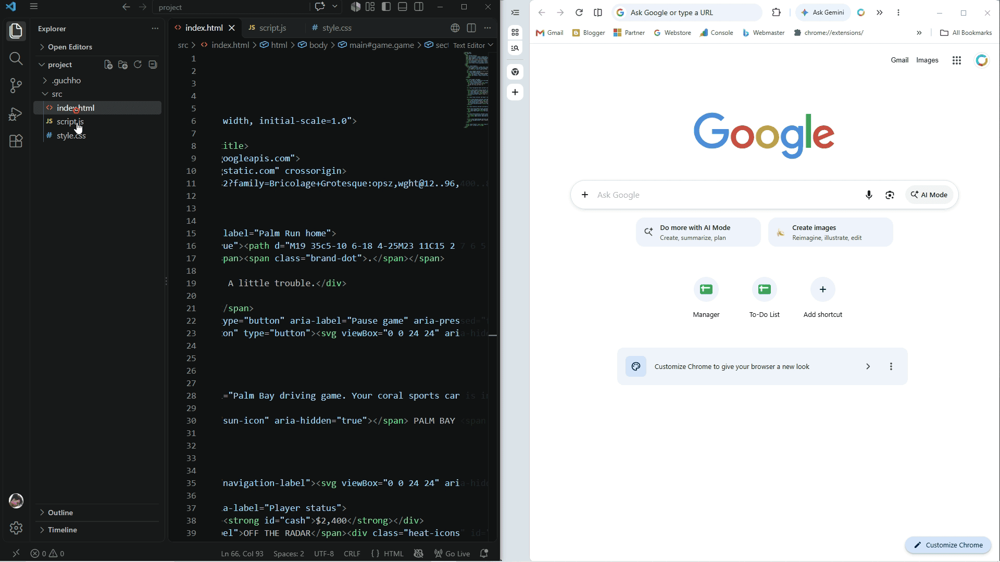

# Live Server (Guchho)

Instant local server and live browser preview for VS Code, powered by [Guchho](https://guchho.js.org).

## Features

- Click **Go Live** in the status bar to start or stop the server
- Right-click an HTML file in the Explorer and choose **Open with Live Server**
- Right-click inside an HTML editor and choose **Open with Live Server**
- Use the Command Palette to open or stop the server
- Keyboard shortcuts: `alt+l alt+o` to open, `alt+l alt+c` to stop
- Open in browser, restart, and live preview of the selected HTML page
- Uses Guchho's dev server with file watching and automatic rebuilds
- Creates and opens `guchho.config.json` when the project has no Guchho config
- Generated preview output goes to `.guchho/dist`
- Powered by Guchho's fast native server
- Platform-specific binaries for optimal performance

## Configuration

If no Guchho config (`guchho.config.js`, `guchho.config.json`, or `guchho.json`) is found, the extension creates a `guchho.config.json` in the served project root and opens it once. The generated config uses the selected HTML file as the entry and `.guchho/dist` as the output directory.

- `liveServerGuchho.host`: Host to bind (default: 127.0.0.1)
- `liveServerGuchho.port`: Port to bind (default: 5500)
- `liveServerGuchho.root`: Root directory to serve (default: .)
- `liveServerGuchho.openBrowser`: Auto-open browser on start (default: true)

## Commands

- `Live Server: Open with Live Server`
- `Live Server: Stop Live Server`
- `Live Server: Restart Live Server`
- `Live Server: Open in Browser`
- `Live Server: Toggle Live Server`

## Keybindings

- Open server: `alt+l alt+o` (`cmd+l cmd+o` on macOS)
- Stop server: `alt+l alt+c` (`cmd+l cmd+c` on macOS)

Shortcuts can be changed in **Keyboard Shortcuts**.

## License

Live Server (Guchho) is licensed under **MIT**. Copyright © [CodeHemu](https://codehemu.in/).